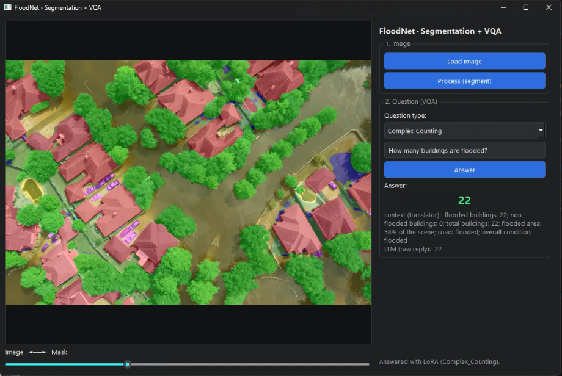
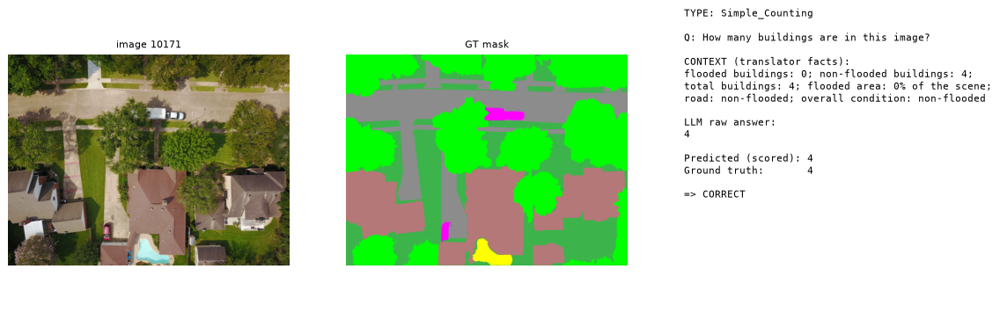
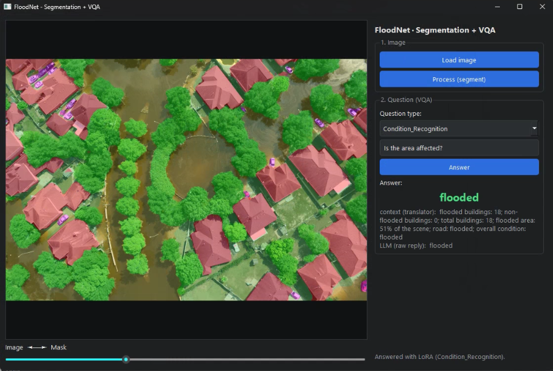
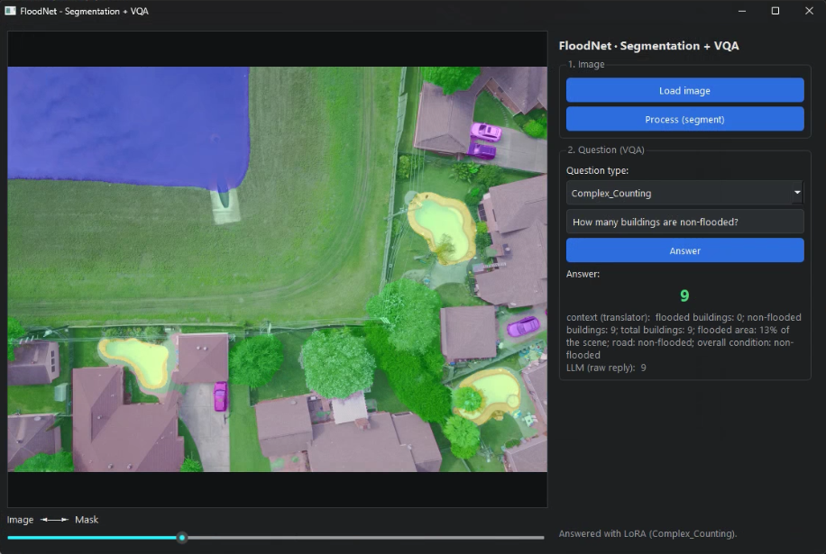
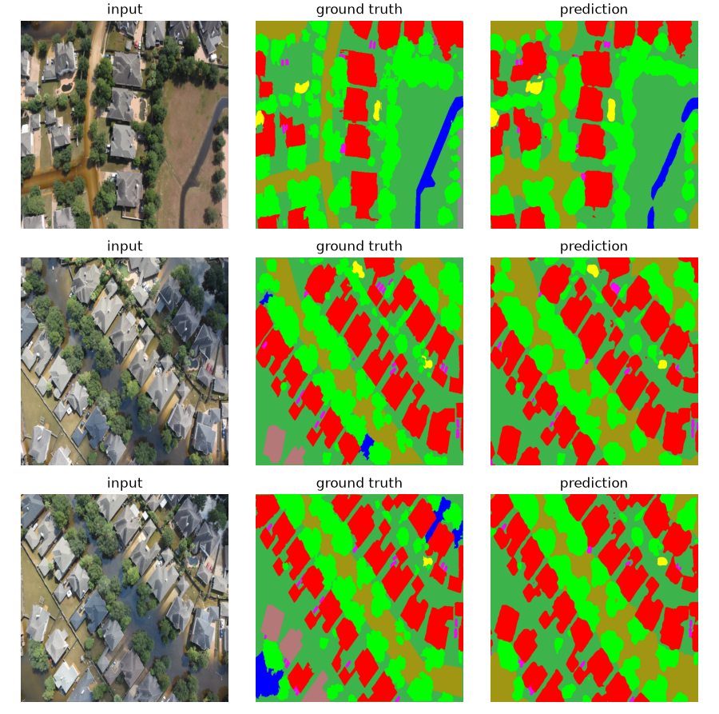
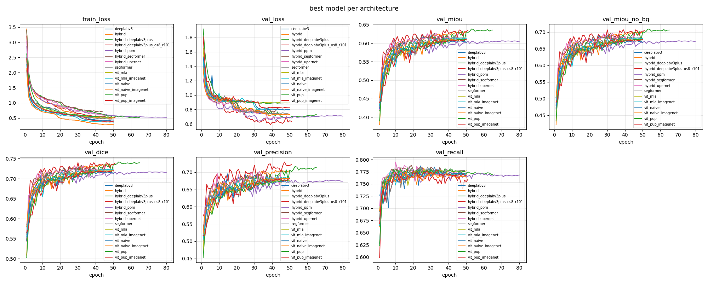
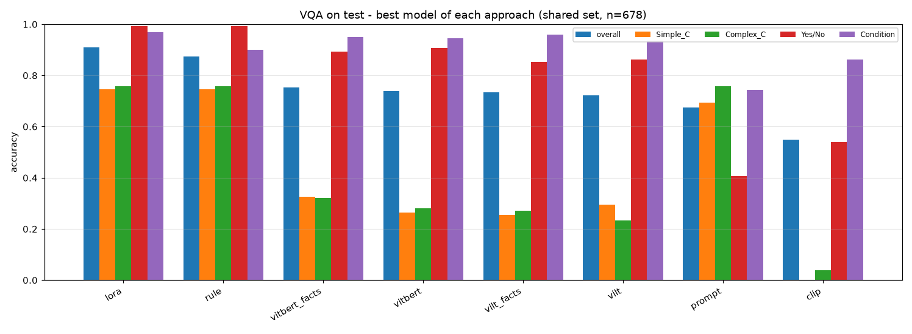
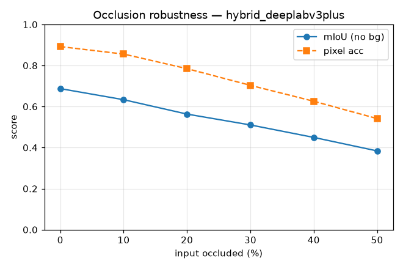

# FloodNet Segmentation + VQA

Segment a post-flood aerial photo, turn the mask into facts, and let a small
language model answer operational questions about the scene.



## What this is

Post-flood aerial imagery is usually read by hand: someone opens the photo and
counts how many houses are under water, whether the road is passable, and how bad
the scene is overall. Visual Question Answering models can answer that kind of
question directly from the image, but they are poor at counting.

This project takes a different route. It segments the scene first, converts the
mask into an explicit list of facts (building counts, flooded area, road state),
and lets a small language model answer the question from those facts instead of
from raw pixels.

```
image -> segmentation (HybridSeg) -> mask -> translator -> facts -> LLM reader -> answer
```

One test example, end to end:



The translator counted 4 buildings from the mask, wrote that into a sentence, and
the LoRA-tuned reader answered "4". Nothing in that chain looks at the pixels
except the segmentation model.

Built as the research project for an MSc in Artificial Intelligence at the
University of Lincoln, on the FloodNet dataset (Hurricane Harvey, UAV imagery).

## Requirements

- Python 3.9 or newer (tested on 3.13)
- An NVIDIA GPU with 8 to 12 GB for training. The app runs on CPU.

To only try the app you need neither a GPU nor the dataset: install, download one
checkpoint, run. The dataset is required from [Dataset](#dataset) onwards.

## Install

Two environments, because the app needs far less than training does.

**Demo app (CPU).** On Windows, double-click `install_app.bat`. It creates
`.venv_app`, installs CPU PyTorch plus `requirements_app.txt`, and opens the app.
Afterwards use `run_app.bat`, or `launch_app.vbs` to start it without a console
window.

Manually, or on Linux/macOS:

```bash
python -m venv .venv_app
source .venv_app/bin/activate      # Windows: .venv_app\Scripts\activate
pip install torch torchvision --index-url https://download.pytorch.org/whl/cpu
pip install -r requirements_app.txt
```

**Training.** PyTorch is deliberately not in `requirements.txt`, because the
GPU build has to come from the CUDA index:

```bash
python -m venv .venv
source .venv/bin/activate          # Windows: .venv\Scripts\activate
pip install torch torchvision --index-url https://download.pytorch.org/whl/cu121
pip install -r requirements.txt
```

## Model weights

The LoRA adapter (3.3 MB) is in this repository at
`experiments/vqa/lora/adapter/`. The two large checkpoints are attached to the
[latest release](https://github.com/ChrisDan-Col/floodnet-segmentation-vqa/releases/latest)
because they exceed the 100 MB file limit on GitHub.

| File | Size | Needed for | Goes in |
|---|---|---|---|
| `best.pt` | 166 MB | the app, and any segmentation inference | `experiments/segmentation/hybrid_deeplabv3plus/` |
| `mae_encoder.safetensors` | 427 MB | only to retrain segmentation with `--init mae` | `experiments/ssl_mae/default/encoder_best/model.safetensors` |

Download the segmentation checkpoint:

```bash
mkdir -p experiments/segmentation/hybrid_deeplabv3plus
curl -L -o experiments/segmentation/hybrid_deeplabv3plus/best.pt \
  https://github.com/ChrisDan-Col/floodnet-segmentation-vqa/releases/latest/download/best.pt
```

PowerShell:

```powershell
Invoke-WebRequest -Uri "https://github.com/ChrisDan-Col/floodnet-segmentation-vqa/releases/latest/download/best.pt" -OutFile "experiments\segmentation\hybrid_deeplabv3plus\best.pt"
```

If the file is missing, the app asks you to browse for it instead of crashing.

The LoRA adapter sits on top of `ank028/Llama-3.2-1B-Instruct-medmcqa`. That base
model (about 2.4 GB) is downloaded from Hugging Face the first time you ask a
question, so the first answer takes a few minutes and needs internet. Later
questions use the cache. If the LLM cannot load at all, the app falls back to the
deterministic rule reader.

## Run the app

```bash
python app.py
```

A single screen runs the whole pipeline live. Load an aerial image, press
**Process (segment)**, then drag the slider to fade between the photo and the
mask. Pick a question type, type a question, press **Answer**.

Counting on a flooded scene, and the same question inverted on a dry one:

| | |
|---|---|
|  |  |

Under the answer the app prints the facts the translator extracted plus the raw
LLM reply, so you can see exactly what the model was given and what it said
before the answer was scored.

The facts only cover buildings, roads and the overall flood condition, so the app
rejects questions about trees, vehicles, pools or people. That is not a
limitation of the code but of the dataset: across all 4511 FloodNet questions,
those words never appear.

## Dataset

Needed only to retrain or re-evaluate. FloodNet is not redistributed here. It
comes from two places, and both are needed because they are packaged differently:

- Segmentation, images and masks:
  [FloodNet-Supervised_v1.0](https://github.com/BinaLab/FloodNet-Supervised_v1.0)
- VQA questions, Tracks 1 and 2:
  [Kaggle mirror](https://www.kaggle.com/datasets/aletbm/aerial-imagery-dataset-floodnet-challenge)

The Kaggle part can be fetched with `python download_kaggle.py` (needs
`kagglehub` and Kaggle credentials).

Extract both into a `Datasets/` folder next to the scripts:

```
Datasets/
  FloodNet-Supervised_v1.0/
    train/  (train-org-img, train-label-img)
    val/    (val-org-img,   val-label-img)
    test/   (test-org-img,  test-label-img)
  FloodNet Challenge - Track 1/
  FloodNet Challenge - Track 2/
    Images/
    Questions/Training Question.json
```

If you keep the data elsewhere, edit `DATA_ROOT` at the top of
`prepare_segmentation.py` and `prepare_vqa.py`.

## Reproduce the pipeline

The CSV splits and the extracted facts are already committed under
`prepared_data/`, so you can skip step 1 unless you changed the data.

**1. Prepare the splits**

```bash
python prepare_segmentation.py    # seg_{train,val,test}.csv + ssl_images.csv
python prepare_vqa.py             # vqa_{train,val,test}.csv, split by image
```

Segmentation uses the official on-disk split (1445 / 450 / 448). VQA is split by
image, not by question, so no scene leaks between train and test.

**2. Self-supervised pre-training (optional)**

Masked autoencoder on 1900 unlabelled images, with the 448 test images held out
so the encoder never sees them.

```bash
python train_ssl.py
python compare_experiments.py --stage ssl
```

**3. Segmentation**

```bash
python train_hybrid.py                 # the winning config
python train_hybrid.py --test          # evaluate on the official test split
python train_hybrid.py --occlusion_eval --test    # the occlusion curve below
python compare_experiments.py --stage seg --best  # table of every architecture
```

Other architectures for comparison:

```bash
python train_seg.py --arch deeplabv3
python train_seg.py --arch segformer
python train_seg.py --init mae         # ViT + PUP, MAE encoder
python train_seg.py --init imagenet
python train_hybrid.py --decoder ppm   # or upernet, segformer
```

Report `miou_no_bg`. The mIoU that includes background is not comparable to the
FloodNet paper.

At 640 px on 8 GB, use `--batch_size 4 --grad_checkpoint 1`.

**4. Mask to facts**

```bash
python translate_masks.py --masks_csv ".\prepared_data\seg_train.csv,.\prepared_data\seg_val.csv,.\prepared_data\seg_test.csv" \
  --vqa_csv ".\prepared_data\vqa_train.csv,.\prepared_data\vqa_val.csv,.\prepared_data\vqa_test.csv" \
  --out .\prepared_data\facts_gt.json
```

Pass all three segmentation CSVs. The VQA and segmentation splits are
independent, so a single split does not cover every questioned image, and the
facts file has to cover all of them before training anything downstream.

Building counts come from connected components (`scipy.ndimage.label`) with small
blobs discarded. Flooded area is flooded pixels over non-background pixels, and a
scene counts as flooded above 30 percent, the threshold from the FloodNet paper.
The translator is deterministic; nothing is trained here.

**5. VQA**

```bash
python vqa.py --approach rule   --facts .\prepared_data\facts_gt.json
python vqa.py --approach lora   --facts .\prepared_data\facts_gt.json --lora_epochs 3 --batch_size 4
python vqa.py --approach lora   --test --facts .\prepared_data\facts_gt.json
python vqa.py --approach vilt   --images_dir ".\Datasets\FloodNet Challenge - Track 2\Images"
python vqa.py --approach all    --test --images_dir "..." --facts .\prepared_data\facts_gt.json
```

`--approach all --test` scores every saved model on the same test rows and writes
the comparison table and the bar chart below to
`experiments/vqa/_test_comparison/`.

## Results

### Segmentation

Official FloodNet test split, mean IoU over the 9 classes (background excluded,
which is how the FloodNet paper reports it):

| Model | mIoU (9 classes) |
|---|---|
| **HybridSeg (this repo)** | **0.692** |
| DeepLabV3+ (paper baseline) | 0.586 |
| ENet (paper baseline) | 0.398 |

HybridSeg is a dilated ResNet-50 backbone, an ASPP context module, one
Transformer block between them, and a DeepLabV3+ decoder with a low-level skip.
40.9M parameters.



Fourteen configurations were trained to get there: four decoder heads, plain ViT
with three decoders, SegFormer, DeepLabV3, and two encoder initialisations (MAE
self-supervised vs ImageNet). The green curve pulling ahead in `val_miou_no_bg`
is HybridSeg with the DeepLabV3+ head.



Two findings worth reading off that plot. The plain ViT variants fit the training
set hardest and generalise worst (train/val gap 0.33 to 0.43, against 0.15 for
DeepLabV3); on 1445 training images a strong inductive bias beats a flexible one.
And MAE pre-training on 2k in-domain images came out roughly tied with ImageNet
transfer, which is reported here as it happened rather than dropped.

### VQA

Same test rows for every method (n=678), exact-match accuracy:

| Approach | Overall | Simple count | Complex count | Yes/No | Condition |
|---|---|---|---|---|---|
| **lora** (facts + LoRA-tuned LLM) | **0.909** | 0.745 | 0.757 | 0.992 | 0.968 |
| rule (facts + hand-written rules) | 0.873 | 0.745 | 0.757 | 0.992 | 0.899 |
| vitbert + facts | 0.754 | 0.327 | 0.320 | 0.892 | 0.951 |
| vitbert | 0.739 | 0.265 | 0.282 | 0.908 | 0.945 |
| vilt + facts | 0.733 | 0.255 | 0.272 | 0.854 | 0.960 |
| vilt | 0.723 | 0.296 | 0.233 | 0.862 | 0.937 |
| prompt (frozen LLM) | 0.674 | 0.694 | 0.757 | 0.408 | 0.744 |
| clip (zero-shot) | 0.550 | 0.000 | 0.039 | 0.538 | 0.862 |



The orange and green bars are where the argument lives. Holistic classifiers
score 0.26 to 0.33 on counting questions; anything reading the segmentation facts
scores 0.75. The LoRA reader also generates free text, so it is not limited to
the answer vocabulary it saw during training.

### Robustness to occlusion

The segmentation model was trained with random erasing, so it has to use context
rather than the erased region. Covering a growing share of the input with a grey
box degrades it smoothly instead of collapsing:



## Repository layout

```
app.py                  desktop demo (PySide6), the whole pipeline in one screen
train_ssl.py            masked autoencoder pre-training
train_seg.py            segmentation: ViT/SegFormer/DeepLabV3 variants
train_hybrid.py         HybridSeg, the winning architecture
translate_masks.py      mask -> facts
vqa.py                  all VQA approaches behind --approach
compare_experiments.py  comparison tables and curves
prepare_*.py            build the splits from the raw dataset
seg_metrics.py utils.py shared helpers

prepared_data/          committed splits, facts and example figures
experiments/            metrics, curves, confusion matrices, LoRA adapter
figures/                the figures used in this README
app_captures/           screenshots of the app
```

Raw run output lives under `experiments/`: `history.csv` and `curves.png` per
run, `test_metrics.json` with per-class IoU, F1, precision, recall and the
confusion matrix, plus the qualitative examples the VQA scripts save for every
approach.

## Known limits

- Nine classes are heavily imbalanced. Grass alone is 53 percent of the pixels
  and flooded buildings are 0.18 percent, which is why per-class IoU matters more
  than the mean.
- Segmentation mIoU drops from 0.687 to 0.384 as occlusion goes from 0 to 50
  percent of the input.
- Counting depends on connected components, so touching buildings merge into one
  blob. This is where the remaining counting error lives.
- Condition answers are 84 percent "non flooded" in the dataset, so a
  majority-class baseline already reaches 0.84 on that question type. Read the
  per-type numbers, not just the overall accuracy.
- Everything is trained on a single event, Hurricane Harvey.

## License

MIT, see [LICENSE](LICENSE). The FloodNet dataset keeps its own license and is
not redistributed here.

## Acknowledgements

FloodNet: Rahnemoonfar et al., *FloodNet: A High Resolution Aerial Imagery
Dataset for Post Flood Scene Understanding*, IEEE Access, 2021.

Supervised by Dr. Christos Frantzidis at the University of Lincoln.
